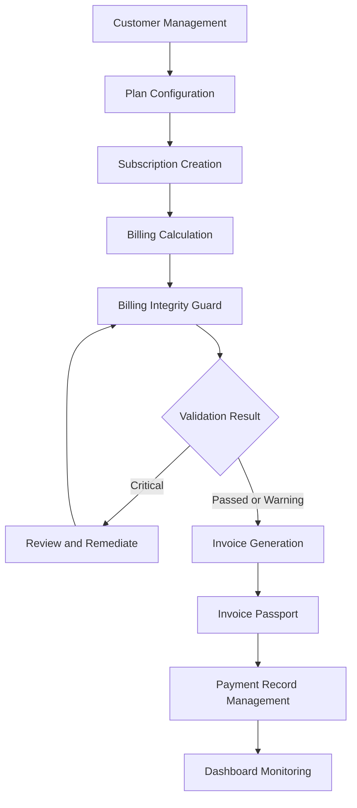
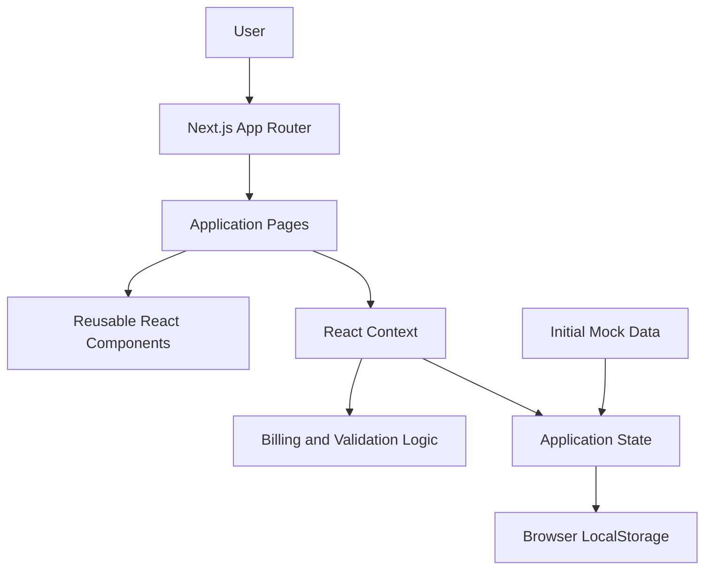

# SubSync
### Subscription Management & Billing Integrity Platform

**Manage subscriptions. Validate billing. Protect invoice accuracy.**

SubSync is a subscription and recurring billing management platform designed to help businesses organize customer subscriptions, manage pricing plans, calculate recurring charges, monitor payment records, and identify billing inconsistencies before invoice generation.

It combines subscription administration with a billing calculation engine, a rule-based billing integrity workflow, and invoice calculation transparency in one interface.

---

## Table of Contents

- [Overview](#overview)
- [Problem Statement](#problem-statement)
- [Our Solution](#our-solution)
- [Core Features](#core-features)
- [Application Modules](#application-modules)
- [How It Works](#how-it-works)
- [Billing Calculation](#billing-calculation)
- [Billing Integrity Guard](#billing-integrity-guard)
- [Invoice Passport](#invoice-passport)
- [Technology Stack](#technology-stack)
- [System Architecture](#system-architecture)
- [Project Structure](#project-structure)
- [Getting Started](#getting-started)
- [Available Commands](#available-commands)
- [Data Management](#data-management)
- [Current Implementation Scope](#current-implementation-scope)
- [Future Enhancements](#future-enhancements)
- [Contributing](#contributing)
- [License](#license)

---

## Overview

Subscription-based businesses often manage multiple customers, pricing plans, recurring billing cycles, discounts, taxes, invoices, and payment records.

As these operations grow, maintaining billing accuracy becomes increasingly important.

A small inconsistency in subscription pricing, an expired discount, an incorrect billing period, or an invalid subscription status can lead to inaccurate invoices and financial discrepancies.

SubSync provides a centralized interface for managing these operations and introduces a billing integrity workflow to help identify and address potential inconsistencies before invoice generation.

### Key Objectives

- Centralize subscription and customer management.
- Simplify recurring billing calculations.
- Support pricing, seat, discount, tax, and proration scenarios.
- Identify billing inconsistencies through rule-based validation.
- Provide controlled remediation workflows.
- Maintain invoice calculation details for transparency.
- Monitor invoice and payment statuses.

---

## Problem Statement

Businesses managing recurring subscriptions can encounter several operational challenges:

| Challenge | Potential Impact |
|---|---|
| Incorrect subscription pricing | Incorrect invoice amounts |
| Expired promotional discounts | Revenue leakage |
| Duplicate or overlapping billing periods | Duplicate charges |
| Inactive or suspended accounts | Invalid billing operations |
| Incorrect tax calculations | Financial discrepancies |
| Lack of calculation transparency | Difficult invoice verification |
| Disconnected subscription and invoice records | Increased manual effort |

Traditional subscription tracking often focuses on recording transactions rather than validating the underlying billing information.

SubSync addresses this gap by combining subscription management, billing calculations, validation, and invoice traceability.

---

## Our Solution

SubSync introduces a structured subscription-to-invoice workflow.

Instead of treating invoice generation as an isolated operation, the application provides separate stages for:

1. Managing customers, plans, and subscriptions.
2. Calculating recurring billing amounts.
3. Simulating pricing and billing changes.
4. Checking subscription records for configured integrity conditions.
5. Applying supported remediation actions.
6. Generating invoices from eligible subscriptions.
7. Reviewing invoice calculation details and payment statuses.

The objective is to make billing operations easier to understand, verify, and manage.

---

## Core Features

### 1. Subscription Management

Manage subscription records through a centralized interface.

- Create and update subscriptions.
- Associate subscriptions with customers and plans.
- Configure seat counts and unit prices.
- Maintain billing periods and renewal dates.
- Manage subscription statuses.
- Track subscription integrity status.

### 2. Customer Management

Maintain customer information required for subscription operations.

- Customer name and contact information.
- Company information.
- Billing address.
- GST identification details.
- Customer status.
- Invoice totals and active subscription counts.

### 3. Plan Management

Configure subscription pricing plans.

- Monthly and yearly billing intervals.
- Base pricing.
- Included seats.
- Additional seat pricing.
- Maximum seat limits.
- Plan features.
- Annual discount configuration.

### 4. Billing Calculation Engine

Calculate billing amounts using configurable parameters.

Supported calculation inputs include:

- Base subscription price.
- Number of seats.
- Discount percentage.
- Tax percentage.
- Active billing days.
- Total billing period days.
- Proration configuration.

The calculation interface provides a breakdown of the resulting billing amount.

### 5. Billing Integrity Guard

A rule-based validation workflow that evaluates subscription records and identifies configured billing inconsistencies.

The interface provides:

- Integrity check results.
- Passed, warning, and critical classifications.
- Explanations for detected conditions.
- Suggested remediation actions.
- Supported automatic remediation operations.
- Invoice generation protection for subscriptions marked critical.

### 6. Billing Simulator

Explore hypothetical billing changes without directly modifying the selected subscription.

Users can experiment with:

- Pricing changes.
- Seat adjustments.
- Discount changes.
- Tax rate changes.
- Prorated billing scenarios.

The simulator compares the baseline calculation with the proposed scenario.

### 7. Invoice Management

Generate and manage invoice records associated with subscriptions.

- Generate invoices from subscriptions.
- Maintain invoice line items.
- Track issue and due dates.
- View invoice totals.
- Manage invoice statuses.
- Review associated payment information.

### 8. Invoice Passport

Provides a calculation breakdown associated with an invoice.

The invoice record includes a calculation snapshot containing information such as:

- Base price.
- Seat count.
- Subtotal.
- Discount amount.
- Taxable amount.
- GST rate.
- CGST and SGST.
- Final amount.
- Calculation timestamp.
- Formula and explanation.

This helps users understand how an invoice amount was derived.

### 9. Payment Monitoring

Manage payment records and monitor their statuses.

Supported payment methods in the application include:

- UPI.
- Net Banking.
- Credit Card.
- Bank Transfer.

Payment records can be classified as Paid, Pending, or Failed.

**Note:** Payment records in the current implementation are application-managed demo records. They do not represent transactions processed by a live payment gateway.

### 10. Dashboard & Financial Overview

A centralized dashboard provides an overview of subscription and billing operations.

It includes:

- Key subscription metrics.
- Monthly recurring revenue calculations.
- Pending invoice amounts.
- Billing integrity status counts.
- Revenue visualization.
- Upcoming renewals.
- Recent invoice information.

### 11. Application Settings

Configure application-level business information and billing preferences.

- Business name and address.
- GSTIN.
- Support email.
- Currency settings.
- Default GST rate.
- Integrity strictness preference.
- Reset to initial demonstration data.

---

## Application Modules

| Route | Module | Purpose |
|---|---|---|
| `/` | Dashboard | Financial and operational overview |
| `/customers` | Customers | Customer record management |
| `/plans` | Plans | Subscription pricing configuration |
| `/subscriptions` | Subscriptions | Subscription lifecycle management |
| `/billing-engine` | Billing Engine | Calculate recurring billing amounts |
| `/billing-guard` | Billing Guard | Validate subscription integrity |
| `/simulator` | Billing Simulator | Compare hypothetical billing scenarios |
| `/invoices` | Invoices | Generate and manage invoices |
| `/invoice-passport` | Invoice Passport | Inspect invoice calculation details |
| `/payments` | Payments | Monitor payment records |
| `/settings` | Settings | Configure business and application preferences |

---

## How It Works

### Subscription-to-Invoice Workflow



### Workflow Explanation

**Step 1 — Customer and Plan Setup**

Create customer records and configure pricing plans.

**Step 2 — Subscription Creation**

Associate customers with plans and configure subscription details such as pricing, seats, billing periods, and renewal dates.

**Step 3 — Billing Calculation**

Calculate the expected billing amount using the configured subscription parameters.

**Step 4 — Integrity Validation**

Run the Billing Integrity Guard to evaluate supported validation rules.

**Step 5 — Remediation**

Review detected issues and apply available remediation operations where appropriate.

**Step 6 — Invoice Generation**

Generate an invoice from an eligible subscription.

**Step 7 — Calculation Transparency**

Inspect the invoice calculation snapshot through Invoice Passport.

**Step 8 — Payment Monitoring**

Maintain payment records and monitor their statuses.

---

## Billing Calculation

The billing engine supports the calculation of recurring subscription charges using the following general model.

### Standard Billing

Let:

- `P` = Base price per seat.
- `S` = Number of seats.
- `D` = Discount percentage.
- `T` = Tax percentage.

**1. Gross Subtotal**

```text
Gross Subtotal = P × S
```

**2. Discount Amount**

```text
Discount = Gross Subtotal × (D / 100)
```

**3. Taxable Amount**

```text
Taxable Amount = Gross Subtotal - Discount
```

**4. Tax Amount**

```text
Tax = Taxable Amount × (T / 100)
```

**5. Final Amount**

```text
Final Amount = Taxable Amount + Tax
```

### GST Breakdown

For the application's equal CGST/SGST calculation model:

```text
CGST = Taxable Amount × (T / 200)

SGST = Taxable Amount × (T / 200)

Total GST = CGST + SGST
```

### Prorated Billing

The billing engine also supports prorated calculation inputs.

A general proration model is:

```text
Prorated Amount =
Full Period Amount × (Active Days / Total Period Days)
```

The actual calculation behaviour is determined by the implemented billing calculation logic.

---

## Billing Integrity Guard

Billing Integrity Guard is a rule-based validation module designed to identify potential inconsistencies in subscription records.

### Integrity Classification

| Classification | Meaning |
|---|---|
| Passed | The evaluated checks did not identify a configured issue |
| Warning | A condition requires review |
| Critical | A condition requires attention and can block invoice generation |

### Supported Remediation Operations

The current application includes remediation operations for:

- Clearing duplicate billing-period conditions.
- Removing expired discounts.
- Synchronizing subscription pricing with the associated plan catalog.
- Reactivating an account.

### Invoice Protection

The invoice-generation workflow checks the subscription's integrity status.

Subscriptions marked Critical are blocked from invoice generation until the relevant condition is addressed.

**Important:** This is an application-level demonstration of rule-based validation. It is not an independent financial audit, statutory compliance certification, or guarantee that every possible billing error will be detected.

---

## Invoice Passport

Invoice Passport provides visibility into the calculation information stored with an invoice.

Each generated invoice contains a calculation snapshot.

This snapshot makes it possible to inspect the inputs and intermediate values used to arrive at the final amount.

### Why It Matters

- Improves calculation transparency.
- Makes invoice amounts easier to review.
- Preserves calculation information with the invoice record.
- Helps users understand discounts and taxes.
- Supports manual verification of billing results.

The current implementation stores the snapshot in application state; it is not a tamper-proof external audit ledger.

---

## Technology Stack

| Technology | Purpose |
|---|---|
| Next.js 14 | Application framework |
| React 18 | User interface |
| TypeScript | Type-safe application development |
| Tailwind CSS 3 | Styling and responsive layouts |
| Lucide React | Interface icons |
| clsx | Conditional class handling |
| tailwind-merge | Tailwind class conflict resolution |
| Browser LocalStorage | Client-side application state persistence |
| npm | Dependency and package management |

### Application Architecture

The project uses the Next.js App Router with a component-based React architecture.

The main application state is managed through React Context and React state hooks.

The current implementation uses:

- Reusable UI components.
- Shared application context.
- Typed domain models.
- Separate application routes.
- Client-side persistence.
- Local demonstration data.

---

## System Architecture



### Architecture Responsibilities

| Layer | Responsibility |
|---|---|
| Presentation | Pages, forms, tables, cards, and navigation |
| Application | User interactions and workflow coordination |
| Business Logic | Billing calculations and integrity validation |
| State Management | Customer, plan, subscription, invoice, payment, and settings state |
| Persistence | Browser LocalStorage |
| Initial Data | Preconfigured demonstration records |

---

## Project Structure

```text
SubSync/
│
├── public/
│
├── src/
│   ├── app/
│   │   ├── page.tsx
│   │   ├── layout.tsx
│   │   ├── globals.css
│   │   ├── customers/
│   │   ├── plans/
│   │   ├── subscriptions/
│   │   ├── billing-engine/
│   │   ├── billing-guard/
│   │   ├── simulator/
│   │   ├── invoices/
│   │   ├── invoice-passport/
│   │   ├── payments/
│   │   └── settings/
│   │
│   ├── components/
│   │   ├── billing/
│   │   ├── customers/
│   │   ├── dashboard/
│   │   ├── invoices/
│   │   ├── layout/
│   │   ├── subscriptions/
│   │   └── ui/
│   │
│   ├── context/
│   │   └── app-context.tsx
│   │
│   ├── data/
│   │   └── mock-data.ts
│   │
│   ├── lib/
│   │
│   └── types/
│       └── index.ts
│
├── .gitignore
├── next.config.mjs
├── package.json
├── package-lock.json
├── postcss.config.mjs
├── tailwind.config.mjs
└── tsconfig.json
```

---

## Getting Started

Follow these instructions to run SubSync locally.

### Prerequisites

Install the following:

- Node.js 18.17 or later.
- npm.
- Git.
- A code editor such as Visual Studio Code.

Verify the installations:

```bash
node --version
npm --version
git --version
```

### 1. Clone the Repository

```bash
git clone https://github.com/Hima014/SubSync.git
```

### 2. Navigate to the Project

```bash
cd SubSync
```

### 3. Install Dependencies

```bash
npm install
```

### 4. Start the Development Server

```bash
npm run dev
```

### 5. Open the Application

Visit:

```text
http://localhost:3000
```

The application should now be available in your browser.

---

## Available Commands

| Command | Description |
|---|---|
| `npm install` | Install project dependencies |
| `npm run dev` | Start the development server |
| `npm run build` | Create an optimized production build |
| `npm run start` | Start the production server after building |
| `npm run lint` | Run the configured Next.js lint command |

### Production Build

To verify the project:

```bash
npm run build
```

To run the production build locally:

```bash
npm run start
```

---

## Data Management

### Initial Demonstration Data

SubSync currently initializes with sample records for:

- Customers.
- Subscription plans.
- Subscriptions.
- Invoices.
- Payments.
- Business settings.

These records allow users to explore the application without configuring an external database.

### Persistence

Application data is stored in the browser using LocalStorage.

The application uses the following storage key:

```text
subsync_app_state_v1
```

Changes made in the application are persisted in the browser after state hydration.

### Resetting Data

The Dashboard and Settings pages provide a reset option to restore the initial demonstration data.

**Note:** LocalStorage is browser-specific. Data is not synchronized between different users, devices, or browsers.

---

## Current Implementation Scope

SubSync is currently a functional frontend demonstration with client-side state management and sample data.

The following distinctions are important:

| Capability | Current implementation |
|---|---|
| Customer management | Client-side application state |
| Plan management | Client-side application state |
| Subscription management | Client-side application state |
| Billing calculations | Application-level calculation logic |
| Billing integrity checks | Rule-based application validation |
| Invoice generation | Local application records |
| Invoice calculation snapshot | Stored with invoice records |
| Payment monitoring | Demo payment records |
| Data persistence | Browser LocalStorage |
| User authentication | Not implemented |
| Backend API | Not implemented |
| Central database | Not implemented |
| Live payment gateway | Not implemented |
| Email notifications | Not implemented |
| Multi-user synchronization | Not implemented |

### Production Considerations

Before using SubSync to manage real financial operations, the application would require additional engineering, including:

- Secure backend APIs.
- Persistent database storage.
- Authentication and role-based authorization.
- Server-side billing calculations and validation.
- Transaction-safe invoice generation.
- Payment gateway integration.
- Audit logging and access controls.
- Input validation and security testing.
- Backup and recovery mechanisms.
- Appropriate financial and tax compliance review.

The current application should be treated as a demonstration and development project, not as a production financial system.

---

## Future Enhancements

Potential development directions include:

### Backend and Database
- Introduce a persistent relational database.
- Develop secure REST APIs.
- Implement server-side business logic.
- Support multi-user access.

### Authentication and Authorization
- Add secure authentication.
- Introduce administrator and staff roles.
- Enforce role-based permissions.

### Billing and Payments
- Integrate a payment gateway.
- Support automated recurring payment workflows.
- Add transaction reconciliation.
- Improve invoice lifecycle management.

### Billing Integrity
- Expand validation rule coverage.
- Introduce configurable rule definitions.
- Add immutable audit-event storage.
- Implement automated billing anomaly detection.

### Notifications and Reporting
- Add email reminders.
- Introduce renewal notifications.
- Export financial reports.
- Provide advanced analytics.

### Testing and Reliability
- Add unit and integration tests.
- Add end-to-end testing.
- Introduce automated CI workflows.
- Improve error handling and observability.

---

## Contributing

Contributions and suggestions are welcome.

A simple contribution workflow:

1. Fork the repository.
2. Create a feature branch.
3. Implement your changes.
4. Verify the application with `npm run build`.
5. Commit your changes with a meaningful message.
6. Open a Pull Request describing the changes.

Example:

```bash
git checkout -b feature/your-feature
git add .
git commit -m "Add your feature"
git push origin feature/your-feature
```

---

## License

No standalone license file is currently included in the repository. Please contact the repository owner before reusing or redistributing the project.

---

## Repository

**GitHub:** https://github.com/Hima014/SubSync

**Project:** SubSync

**Category:** Subscription Management | Recurring Billing | Billing Integrity

**Framework:** Next.js

---

*SubSync — Bringing clarity, consistency, and transparency to subscription billing.*
